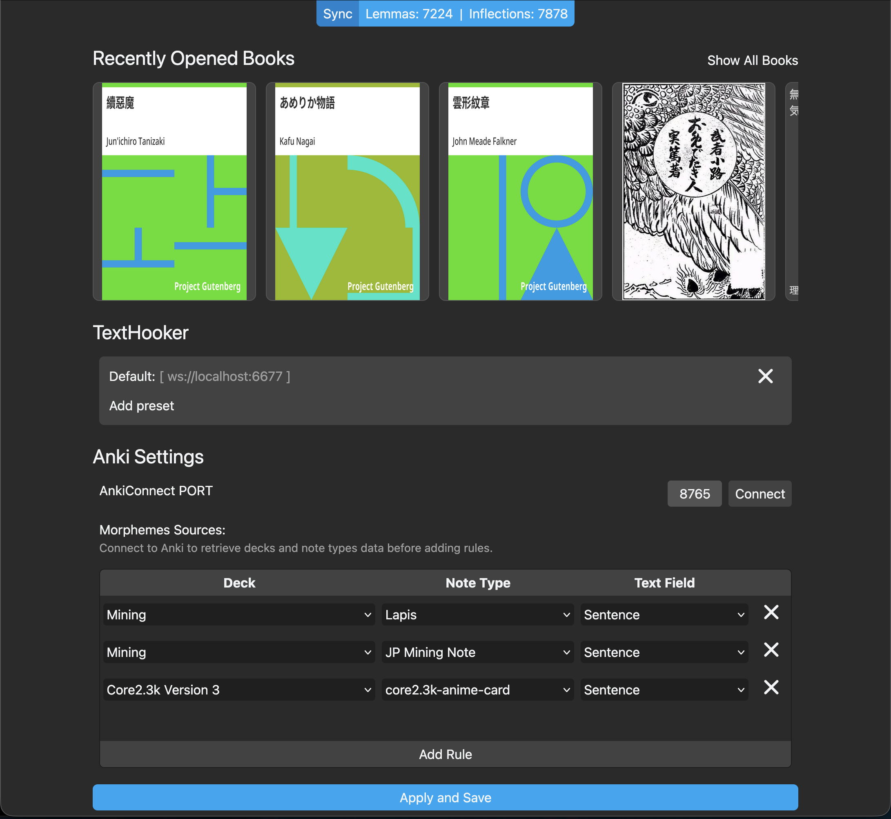
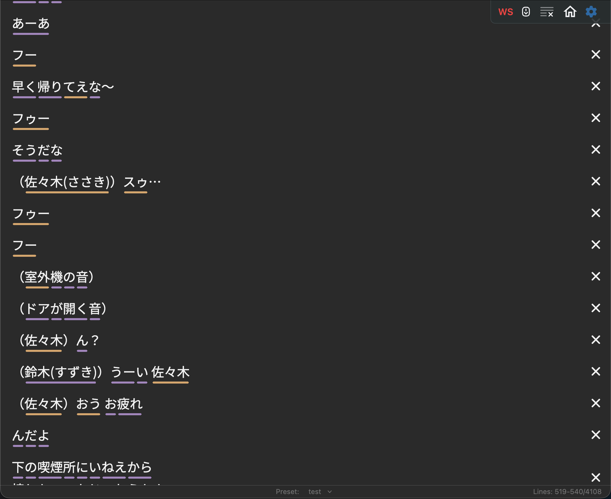
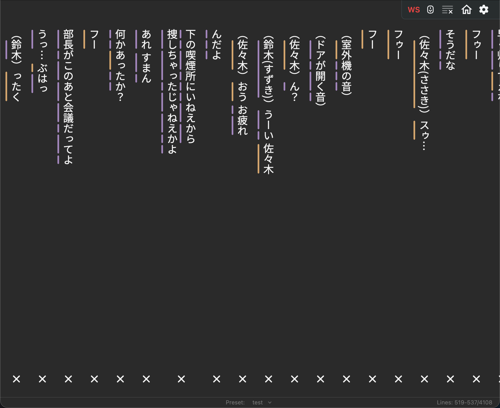
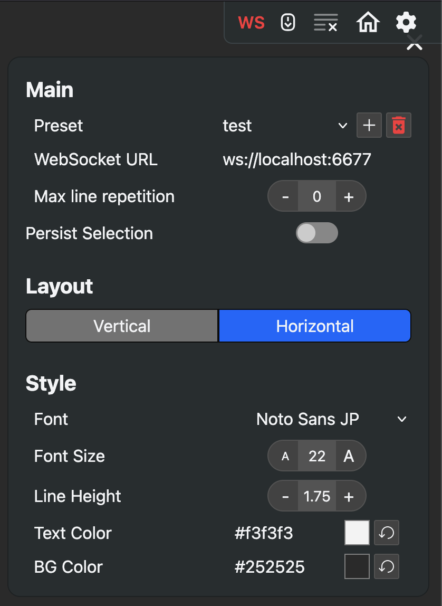
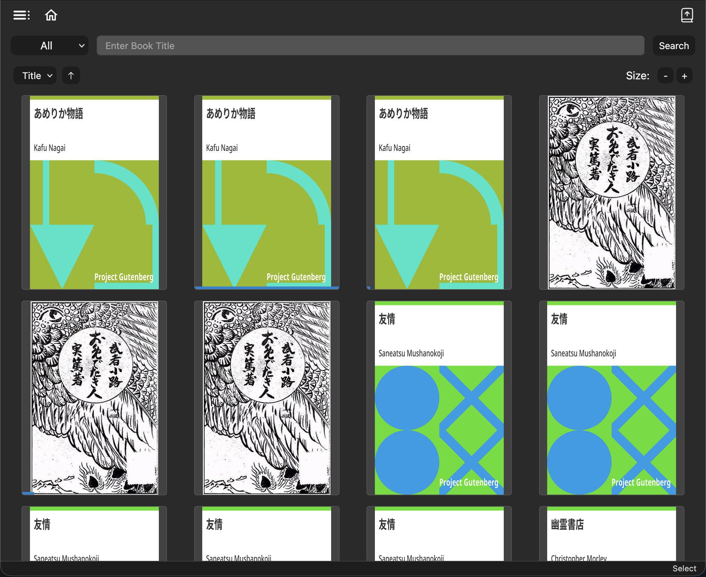
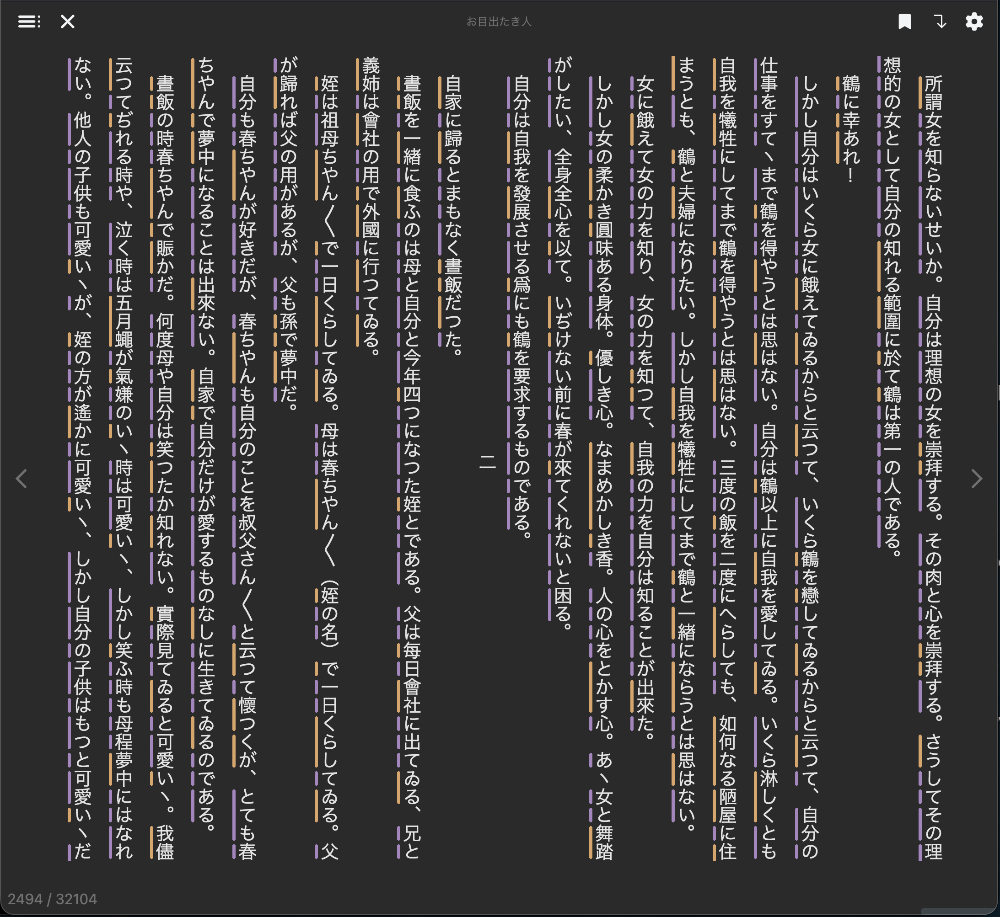
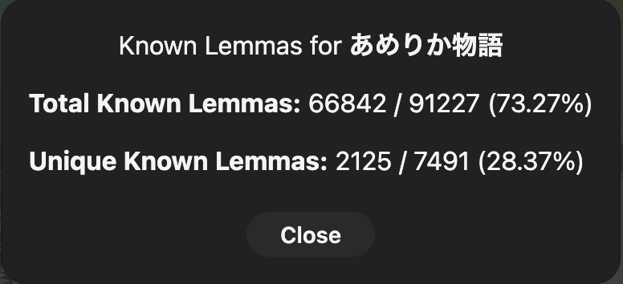

# Jiku

Estimate known vocabulary from Anki decks and apply this data to a 
texthooker interface and epub reader (more in the future). Useful to improve mining efficiency
and to estimate knowledge of the vacabs in each book.


## Installation

The recommended installation method is to use the docker-compose file. Running all components (including the postgresql and redis databases) directly on the host machine is possible by manually passing the necessary environmental variables.

1. Install [Docker](https://docs.docker.com/get-started/get-docker/)
2. Download the `docker-compose.yaml` file from the [releases page](https://github.com/TnTora/Jiku/releases)
3. Run the following command (substituting `<path-to-yaml-file>` with the actual path to the downloaded file) and wait for the installation to complete

If you are using Docker Desktop, make sure it is open before running the command.
```
docker compose -f <path-to-yaml-file> -p jiku up -d
```

Once the command finishes you can stop and start the app from Docker Desktop or Docker CLI.


## Update
In order to update, download the new docker-compose file if it was changed
since your last update then run the following commands.
The first one download the latest images. 
The second recreate the containers.
The last one remove all dangling images.

```
docker compose -f <path-to-yaml-file> pull
docker compose -f <path-to-yaml-file> -p jiku up --force-recreate -d
docker image prune -f
```

## Setup

1. Make sure you have [Anki](https://apps.ankiweb.net/) and the [AnkiConnect](https://ankiweb.net/shared/info/2055492159) plugin installed
2. Config AnkiConnect if the default values do not work. If unable to connect to Anki, 
try changing `webBindAddress` to `0.0.0.0`
3. Open the jiku home page (by default `localhost:5173`), make sure `AnkiConnect PORT` matches the plugin setting and click connect
4. Add the `Morphemes Sources` from which to extract the known words


## Usage

Jiku is currently diveded in three main pages: Home, texthooker interface and epub reader.
The main purpose of this program is to approximate vocabulary knowledge and reflect said knowledge
in by underlining all text inside the user uploaded content using different colors to separate vocab
in the following categories:

- Known: already present at least once in Anki and already studied 
- Unknown: present in Anki but never studied
- Not Found: not found in your Anki profile. Possibly worthy of being mined


### Home



The home page offers a counter of known Lemmas and Inflections in the top bar.

- **Lemmas** are unique and represent the root form of a specific part of speech (best approximation of known vocabulary)
- **Inflection** represents the various forms (for example conjugations) of a part of speech 

The `Sync` button will update the known lemmas and inflections to match your Anki profile based on the rules provided in the table under `Morphemes Sources`.
Before pressing this button make sure Anki is open and AnkiConnect is installed and properly
configured. `AnkiConnect PORT` must match the one specified in the AnkiConnect config.


Under the top bar, the last opened books are shown as well as a list of your presets for the
texthooker interface. You can manage presets from this page by clicking on `Add preset` to create
a new one or clicking the `X` on the right to delete an existing one.

### Tecthooker Page

<p float="left">
  
  
</p>

As of right now, the texthooker interface only supports webscocket connections.
Clipboard monitoring is being considered.

Configure the websocket url in the option panel (the gear icon) and your preferred styling,
then click the `WS` button to connect to the websocket server you specified.
Click again to disconnect.



When you are close to the last line and a new one is added the page will automatically
scroll to the new line.

The texthooker interface is available as a standalone [here]() (without the vocab underlining for now).

### Epub Reader

<p float="left">
  
  
</p>

Click the icon on the top right to upload your books. Currently `epub` is the only
format supported.

Once you have populated your library, you can filter books based on the following properties:

- `Title`
- `Status`: New, Reading, Completed, All

Inside the sidebar (top left icon), you can select a specific author or create and 
delete custom collections.

Once filtered, you can order the results based on: `Title`, `Last Added` or `Last Opened`

To get an insight of how much vocab you know for a specific book, click the tree dots
at the bottom right of the cover and select `Show Stats`.



Planned: get list of known and unknown lemmas ordered by frequency.

## Stack

- Backend: FastAPI, Celery
- Database: postgresql (main), redis (used by Celery)
- Frontend: SvelteKit (+ tailwind css)
